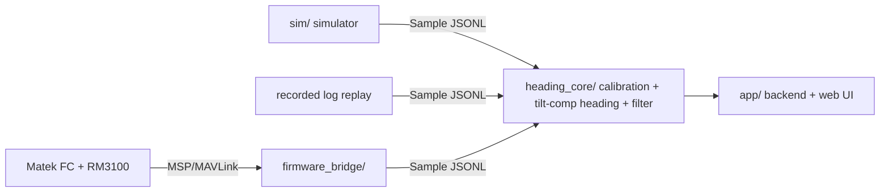

# Architecture (v0.1, PM & CTO)



## Data flow
1. A **source** (sim, replay, or hardware bridge) yields `Sample` objects (see `contracts/sample.schema.json`).
   Transport: newline-delimited JSON over stdout, a file, or TCP `localhost:5760`-style socket.
2. `heading_core` turns samples into `HeadingEstimate` objects (see `contracts/heading_estimate.schema.json`).
3. `app` shows heading (compass rose + numeric), raw/calibrated field, field magnitude, tilt,
   calibration quality, interference warnings, and the source badge.

## Python interfaces (must exist)
```python
# heading_core/__init__.py
class Calibration:            # hard-iron offset (3,), soft-iron matrix (3x3)
    def apply(self, mag_uT) -> list[float]: ...
    @staticmethod
    def fit(samples_uT: list[list[float]]) -> "Calibration": ...   # ellipsoid fit
    def to_dict(self) -> dict; @staticmethod
    def from_dict(d) -> "Calibration": ...

def tilt_compensated_heading(mag_uT, accel_g, declination_deg=0.0) -> float  # deg 0..360, true if decl given
class HeadingEstimator:
    def __init__(self, calibration: Calibration | None = None, declination_deg: float = 0.0): ...
    def update(self, sample: dict) -> dict   # returns HeadingEstimate dict

# sim/ :  python -m sim --rate 50 --duration 60 --scenario <name> [--seed N]  -> JSONL Samples on stdout
# firmware_bridge/ : python -m firmware_bridge --port /dev/ttyACM0 --baud 115200 -> JSONL Samples
#                    (must also support --replay <file> and must emit source="hardware" only from a live port)
# app/ : python -m app --source sim|replay:<file>|serial:<port>   -> serves UI on http://localhost:8080
```

## Frames and units
- Body frame NED-style: x forward, y right, z down. Magnetic field in microtesla (µT). Accel in g. Gyro in deg/s.
- Heading: degrees clockwise from magnetic north (or true north when declination applied), range [0, 360).
- Accelerometer is specific force in g: level and at rest reads (0, 0, -1) in the NED body frame (z down). Firmware bridge must convert FC output to this convention.
- RM3100 raw counts are carried alongside µT when available, with the cycle-count used for conversion.

## Decisions log
- 2026-11-26: Python reference implementation, web UI served locally; JSONL sample contract as the single seam
  between sources and core so sim and hardware are interchangeable.
- 2026-11-27: jsonschema added to requirements. Sim may add extra `truth` keys (true_heading_deg, earth_field_body_uT, field_at_sensor_uT, interference_uT, motor_current_A, declination_deg); `truth.heading_deg` is magnetic heading. Run config carried in the first line's `meta` only. Accel sign convention fixed as above.
- 2026-11-27: Hardware target per T1 is the Matek CAN-L4-3100 module (RM3100 behind AP_Periph); FC receives scaled field (DroneCAN Gauss / MSP mG), not raw counts. `mag_raw` is optional and absent on hardware.
- 2026-11-27 (PM, on T2 review): Warning codes frozen as contract: NOT_CALIBRATED, FIELD_MAGNITUDE_OUT_OF_RANGE, TILT_TOO_LARGE, NO_ACCEL, DIP_ANGLE_ANOMALY, HIGH_NOISE, INVALID_MAG, SENSOR_STALE, MAG_STALE, TIMESTAMP_STALE. New codes need PM sign-off.
- 2026-11-27: Approved optional kwargs `HeadingEstimator(config=CoreConfig)` and `tilt_compensated_heading(..., accel_convention="specific_force")` (defaults preserve the interface above).
- 2026-11-27: Single-calibration rule. The app's ellipsoid calibration is the only calibration. Hardware setup keeps the FC's mag calibration neutral (INAV magzero=0, maggain=1024). The bridge reports `meta.fc_mag_calibrated` (true/false/unknown); the app warns if not false.
- 2026-11-27: Quantised sources. A source whose mag is quantised sets `meta.mag_quant_uT` (MSP: 0.1). When that step is >= 3x the expected noise, MAG_STALE uses bit-identical readings over a longer window (CoreConfig, default 5 s) and does not cut quality below 0.3x. SENSOR_STALE and TIMESTAMP_STALE are unchanged. Thresholds are provisional until a hardware replay log exists.
- 2026-11-27 (PM, on T5 review): Optional `gps` object added to Sample ({fix, num_sat, hdop}) for a read-only GPS-availability indicator. No coordinates, speed or course in the contract or the app. Bridge may fill it from MSP_RAW_GPS (106) as a read-only request; absent means "Unknown".
- 2026-11-27: A replayed file keeps its original `source`, so a replayed sim log shows SIMULATED in the badge with the transport shown separately as replay. Confirmed as intended.
- 2026-11-27: Tests that start the app must bind a free ephemeral port, never a fixed 8080.

- 2026-11-27 (PM, D3): Quantised sources (meta.mag_quant_uT set) raise MAG_STALE only when the mag is bit-identical AND there is motion evidence (gyro integral above a 1 deg/s deadband, or an accel roll/pitch change, threshold 3 deg), with quality x0.3. The no-gyro 5 s time-only rule (`quant_nogyro_time_rule`) is OFF by default. With quantised data a stationary healthy sensor cannot be distinguished from a frozen one. Residual limitation: a mag-only freeze on a stationary vehicle, or during turns slower than 1 deg/s, is undetectable (LIMITATIONS 14a). Provisional; [SIMULATED] evidence only.

- 2026-11-27 (PM, D6, supersedes the line-55 replay rule for hardware data): A sample whose source is `hardware` must never be presented as live when it is replayed. Both `python -m app --source replay:<file>` and `firmware_bridge --replay` relabel it as `source: "replay"` and keep `meta.original_source: "hardware"`. The UI badge then reads `REPLAY (recorded hardware)`, and the banner says the data is recorded and not live. A replayed sim log still shows SIMULATED, since that is the more conservative label, with the transport shown as replay. HARDWARE appears only for a live serial source.
- 2026-11-27 (PM, D6 follow-up): A `hardware` sample POSTed to the ingest endpoint /api/sample keeps its label, but the badge reads `UNVERIFIED SOURCE` and the banner says it is not a live serial source. The app trusts `original_source` as written in a replay file (LIMITATIONS 4). Accepted.

- 2026-11-27 (PM, D8, from Codex audit of f1a0e3e): **A serial connection is not proof of hardware.**
  1. `firmware_bridge` reads the device's self-reported identity over MSP at connect: MSP_API_VERSION, MSP_FC_VARIANT, MSP_FC_VERSION, MSP_BOARD_INFO and MSP_UID where available. It stores this in `meta.device_identity` as values *reported by the device*, not verified.
  2. The fake FC and simulators identify themselves with an FC variant `SIML` and board id `SIMF`. The bridge maps those to `source: "sim"`, so the badge reads SIMULATED.
  3. Any other serial origin, including an unknown, unidentified or failed identity query, is shown as **UNVERIFIED SOURCE**, with the reported board and variant shown as "reported by device".
  4. The HARDWARE badge appears only when the device UID matches an entry in `config/verified_devices.json`. That file ships empty, and an entry may be added only after the HV checklist passes with the Auditor's sign-off and a committed hardware log. Today, nothing can display HARDWARE.
  5. REPLAY (recorded hardware), REPLAY of sim (shown as SIMULATED) and ingest (UNVERIFIED SOURCE) are unchanged. Supersedes L-SER.
  6. Interface added after review (2026-11-27, ChatGPT D8 review; implemented in b27644a, 6c1e5b5):
     - The `meta.device_identity` keys are `fc_variant`, `board_id`, `uid` and `target_name`. `uid` is exactly 24 hex characters, from a 12-byte MSP_UID; any other length is `short` or `bad_length` and gives unverified (F12, edc3ee0).
     - The allowlist is loaded with `firmware_bridge.identity.load_allowlist`, which both the app and the bridge use. The bridge takes a `--verified-devices <path>` flag, and the app passes it the same file. Matching is exact equality only.
     - Trust boundary: the app's server computes `transport`, `device_status`, `device_verified` and `live_hardware` itself. Any provenance or live_hardware claim inside a sample is ignored. HARDWARE requires the app's own serial source, an app-side UID re-check against the allowlist, AND bridge provenance `verified`; the bridge mark can only remove HARDWARE. Samples from any other channel are `untrusted_channel` and shown as UNVERIFIED SOURCE.
     - "verified" means only that the UID matches an administratively trusted list. It is not hardware authentication, and it does not validate the measurements (F11/L11). The display label for allowlisted devices (HARDWARE or ALLOWLISTED DEVICE) is pending the Auditor's decision.
