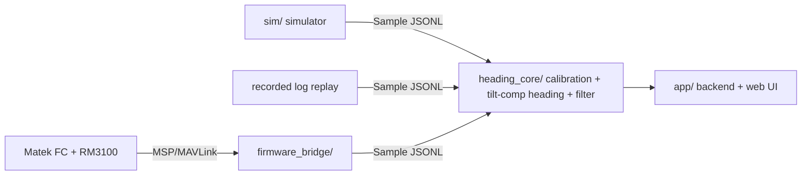

# Architecture (v0.1, PM & CTO)



## Data flow
1. A **source** (sim, replay, or hardware bridge) yields `Sample` objects (see `contracts/sample.schema.json`).
   Transport: newline-delimited JSON over stdout, a file, or TCP `localhost:5760`-style socket.
2. `heading_core` turns samples into `HeadingEstimate` objects (see `contracts/heading_estimate.schema.json`).
3. `app` shows heading (compass rose + numeric), raw/calibrated field, field magnitude, tilt,
   calibration quality, interference warnings, and the source badge.

## Python interfaces (must exist)
```python
# heading_core/__init__.py
class Calibration:            # hard-iron offset (3,), soft-iron matrix (3x3)
    def apply(self, mag_uT) -> list[float]: ...
    @staticmethod
    def fit(samples_uT: list[list[float]]) -> "Calibration": ...   # ellipsoid fit
    def to_dict(self) -> dict; @staticmethod
    def from_dict(d) -> "Calibration": ...

def tilt_compensated_heading(mag_uT, accel_g, declination_deg=0.0) -> float  # deg 0..360, true if decl given
class HeadingEstimator:
    def __init__(self, calibration: Calibration | None = None, declination_deg: float = 0.0): ...
    def update(self, sample: dict) -> dict   # returns HeadingEstimate dict

# sim/ :  python -m sim --rate 50 --duration 60 --scenario <name> [--seed N]  -> JSONL Samples on stdout
# firmware_bridge/ : python -m firmware_bridge --port /dev/ttyACM0 --baud 115200 -> JSONL Samples
#                    (must also support --replay <file> and must emit source="hardware" only from a live port)
# app/ : python -m app --source sim|replay:<file>|serial:<port>   -> serves UI on http://localhost:8080
```

## Frames and units
- Body frame NED-style: x forward, y right, z down. Magnetic field in microtesla (µT). Accel in g. Gyro in deg/s.
- Heading: degrees clockwise from magnetic north (or true north when declination applied), range [0, 360).
- RM3100 raw counts are carried alongside µT when available, with the cycle-count used for conversion.

## Decisions log
- 2026-11-26: Python reference implementation, web UI served locally; JSONL sample contract as the single seam
  between sources and core so sim and hardware are interchangeable.
